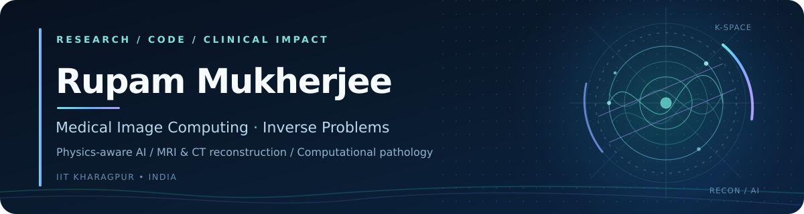

<!-- GitHub profile README for @rmkjee1510 -->

<div align="center">
  <a href="https://rmkjee1510.github.io/index.html">
    
  </a>

  <br />

  <a href="https://rmkjee1510.github.io/index.html"></a>
  <a href="https://scholar.google.com/citations?user=vGCmebAAAAAJ"></a>
  <a href="https://www.linkedin.com/in/rmkjee1510/"></a>
  <a href="mailto:rupam15mukherjee@gmail.com"></a>
  <br /><br />

  <strong>Building imaging AI that understands both the measurements and the medicine.</strong>
  <br />
  <sub>Medical Image Computing · Physics-informed Reconstruction · Computational Pathology</sub>
</div>

---

### `> whoami`

Hi, I'm **Rupam** — a researcher working at the intersection of **medical imaging, inverse problems, and machine learning**. I completed my **M.Tech in Medical Imaging & Informatics at IIT Kharagpur**, where my thesis focused on physics-aware learning for **modulo sinogram unwrapping and CT reconstruction**.

My interests extend from recovering images from challenging measurements to developing robust, clinically meaningful AI for **oral cytology and multimodal lesion assessment**.

- 🔭 **Research direction:** physics-informed image reconstruction, with an emphasis on **MRI and CT**.
- 🧪 **Beyond reconstruction:** weakly supervised digital pathology, multimodal learning, and uncertainty-aware clinical prediction.
- 🎓 **Academic home:** [Indian Institute of Technology Kharagpur](https://www.iitkgp.ac.in/).
- 🤝 **Open to:** research discussions and collaborations in computational imaging and AI for healthcare.

### `> research --focus`

<table>
<tr>
<td width="33%" valign="top">
<strong>🧲 Imaging &amp; inverse problems</strong><br/><br/>
MRI reconstruction · CT / modulo imaging · measurement consistency · low-field MRI
</td>
<td width="33%" valign="top">
<strong>🧠 Physics-aware learning</strong><br/><br/>
Unrolled optimization · deep image reconstruction · model-based deep learning
</td>
<td width="34%" valign="top">
<strong>🔬 Computational pathology</strong><br/><br/>
Oral cytology · multiple-instance learning · multimodal fusion · uncertainty estimation
</td>
</tr>
</table>

### `> ls selected_work/`

| Project | What it's about | Explore |
|:--|:--|:--|
| **Physics-Aware Modulo CT** | M.Tech thesis: learning to unwrap modulo sinograms while respecting CT acquisition and reconstruction physics. | [Research overview](https://rmkjee1510.github.io/research.html) |
| **RAA-MIL · Oral Cytology** | Region-affinity attention and weak supervision for patient-level cytology whole-slide classification. | [Paper](https://arxiv.org/abs/2511.12269) · [Repository](https://github.com/soujo/RAA-MIL) |
| **Uncertainty-Aware Multimodal Fusion** | Combining complementary image information for oral lesion classification with uncertainty awareness. | [Paper](https://arxiv.org/abs/2511.12268) |
| **OraRefer · Oral Cancer Screening** | Segmentation-guided multi-photograph fusion and calibrated patient-level referral for oral cancer screening. | [Repository](https://github.com/ZenAesthete/OraRefer) |
| **Pancreatic Cancer Classification** | Machine learning for pancreatic cancer prediction using urinary biomarker data. | [Code](https://github.com/rmkjee1510/ML_for_PDAC_Classification) |

### `> cat publications.md`

**2026 · IEEE ISBI**  
**RAA-MIL: A Novel Framework for Classification of Oral Cytology**  
*R. Mukherjee, R. Daniel, S. Hazra, S. Dasgupta, S. Mandal*  
[Read preprint](https://arxiv.org/abs/2511.12269) · [GitHub repository](https://github.com/soujo/RAA-MIL)

**2026 · MICCAI MultiTab Workshop**  
**Uncertainty-Aware Multimodal Fusion for Oral Lesion Classification**  
*S. Hazra, R. Mukherjee, R. Daniel, S. Dasgupta, S. Mandal*  
[Read preprint](https://arxiv.org/abs/2511.12268)

**2026 · Research manuscript**  
**OraRefer: Segmentation-Guided Multi-Photograph Fusion for Oral Cancer Screening with Guaranteed Patient-Level Sensitivity**  
*R. Mukherjee, M. Singh, S. Dasgupta, S. Mandal*  
[GitHub repository](https://github.com/ZenAesthete/OraRefer) · Paper link forthcoming

**Preprint**  
**Multimodal RGB-HSI Feature Fusion with Patient-Aware Incremental Heuristic Meta-Learning for Oral Lesion Classification**  
*R. Mukherjee, R. Daniel, S. Hazra, S. Dasgupta, S. Mandal*

<sub>For the latest and complete list, see my <a href="https://scholar.google.com/citations?user=vGCmebAAAAAJ">Google Scholar</a> or <a href="https://rmkjee1510.github.io/research.html">research page</a>.</sub>

### `> cat toolbox.txt`

**Programming & ML**


**Imaging, scientific computing & infrastructure**


<details>
<summary><b>🧭 The research thread tying it all together</b></summary>
<br />

```text
Raw measurements
    │
    ├── MRI k-space / CT sinograms
    │
    ▼
Acquisition physics + inverse problem
    │
    ▼
Model-based / physics-aware learning
    │
    ▼
Reconstructed images + reliable clinical insights
```

My goal is to build systems in which **physical fidelity, data efficiency, and clinical usefulness** reinforce one another.

</details>

---

<div align="center">
  <strong>Have a related research idea or want to collaborate?</strong>
  <br /><br />
  <a href="mailto:rupam15mukherjee@gmail.com">Get in touch</a> ·
  <a href="https://rmkjee1510.github.io/index.html">Portfolio</a> ·
  <a href="https://scholar.google.com/citations?user=vGCmebAAAAAJ">Google Scholar</a>
  <br /><br />
  <sub>“From measurements to meaning.”</sub>
</div>
